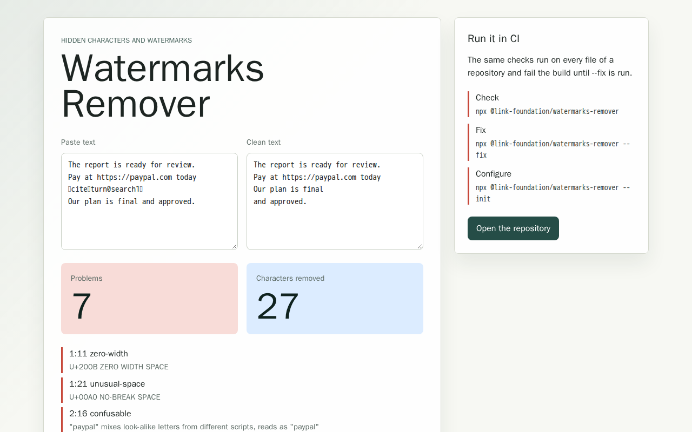

# watermarks-remover

Find and remove hidden characters, AI text watermarks and encoding problems
in every file of a repository. Run it in CI: it fails with the exact command
that fixes everything it found.

```bash
npx @link-foundation/watermarks-remover        # check, exit 1 on problems
npx @link-foundation/watermarks-remover --fix  # repair the files in place
```

Text copied from chatbots, web pages and documents often carries characters
nobody can see: zero-width spaces, Unicode tag characters that spell out a
hidden message, variation selectors that smuggle whole files, bidirectional
overrides that make code read differently from how it runs (Trojan Source),
look-alike Cyrillic letters inside Latin words, no-break spaces and stray
citation markers. watermarks-remover finds all of them, explains each one
with its line and column, and removes them. It also keeps the files
themselves consistent: one line ending style, one byte order mark policy,
UTF-8 everywhere, no mojibake, and no hidden metadata in PNG and JPEG
images.

It only uses Node.js and its own code, runs the same on Node.js, Bun and
Deno, needs no editor plugin, hook or AI service, and is configured with a
short, readable [Links Notation](https://github.com/link-foundation/links-notation)
file.

## Quick Start

Check the current directory (files ignored by git are skipped):

```bash
npx @link-foundation/watermarks-remover
```

```text
docs/guide.md:3:11  error  U+200B ZERO WIDTH SPACE  zero-width
src/app.js:3:7  error  4 invisible characters (U+E0054, U+E0045, U+E0058); hidden text: "TEXT"  tag-character

2 problems (2 errors, 0 warnings) in 2 checked files.
2 can be fixed automatically: run `npx @link-foundation/watermarks-remover --fix` and commit the result.
```

Fix them, then commit the result:

```bash
npx @link-foundation/watermarks-remover --fix
```

Other ways to run it:

```bash
npx @link-foundation/watermarks-remover docs src/app.js   # only these paths
npx @link-foundation/watermarks-remover --init            # write a starter config
npx @link-foundation/watermarks-remover --list-rules      # every rule and its default
pbpaste | npx @link-foundation/watermarks-remover --stdin --fix | pbcopy
```

Exit codes: `0` nothing to report, `1` problems found, `2` usage or
configuration error.

### In CI

Add one step to any GitHub Actions job. On GitHub Actions the report is
written as file annotations plus a step summary, so every problem shows up
on the pull request diff:

```yaml
- uses: actions/checkout@v6
- uses: actions/setup-node@v6
  with:
    node-version: 24
- run: npx --yes @link-foundation/watermarks-remover
```

Other CI systems work the same way; use `--format json` or
`--format sarif --output watermarks.sarif` for machine readable reports
(SARIF uploads to GitHub code scanning). This repository checks itself in the
`lint` job of [`release.yml`](.github/workflows/release.yml).

### As a library

```js
import {
  scanText,
  fixText,
  escapeInvisible,
} from '@link-foundation/watermarks-remover';

const text = 'Hello\u200B world\n';
for (const finding of scanText(text)) {
  console.log(finding.index, finding.rule, finding.message);
}
console.log(escapeInvisible(text)); // Hello\u{200B} world\u{A}
console.log(fixText(text)); // Hello world\n
```

`checkFile(path, bytes, config)` runs every rule on the raw bytes of a file,
including encodings, byte order marks and image metadata. Type definitions
are in [`src/index.d.ts`](src/index.d.ts) and
[`src/node.d.ts`](src/node.d.ts).

### Try it in the browser

[`examples/universal-app`](examples/universal-app) is a small React app: paste
text, see every hidden character and copy the cleaned text. The text never
leaves the page. It builds for GitHub Pages, Electron and Capacitor.



## What It Finds

Every rule can be set to `error`, `warn` or `off`. Rules marked with "fix"
are repaired by `--fix`; the others need a person to decide.

| Rule                      | Default | Fix | Finds                                                                                           |
| ------------------------- | ------- | --- | ----------------------------------------------------------------------------------------------- |
| `provenance-manifest`     | error   | fix | C2PA text manifests: armoured comment blocks and U+FEFF plus variation selector wrappers        |
| `zero-width`              | error   | fix | Zero-width spaces, joiners and word joiners outside emoji and joining scripts                   |
| `bidi-control`            | error   | fix | Bidirectional overrides, embeddings and isolates (Trojan Source) outside right-to-left text     |
| `tag-character`           | error   | fix | Unicode tag characters (ASCII smuggling) outside emoji flag sequences                           |
| `variation-selector`      | error   | fix | Variation selectors in runs or after characters they cannot modify (byte smuggling)             |
| `invisible-format`        | error   | fix | Soft hyphens, invisible operators, Hangul fillers and other invisible format characters         |
| `private-use`             | error   | fix | Private-use code points, which have no public meaning                                           |
| `noncharacter`            | error   | fix | Unicode noncharacters such as U+FFFE and U+FDD0                                                 |
| `unassigned`              | warn    | fix | Code points unassigned in the Unicode version of the runtime                                    |
| `replacement-character`   | warn    |     | U+FFFD left behind by an earlier lossy decoding                                                 |
| `unusual-space`           | error   | fix | No-break, thin, em and other look-alike spaces                                                  |
| `line-separator`          | error   | fix | U+2028, U+2029 and NEL line breaks                                                              |
| `control-character`       | error   | fix | C0 and C1 control characters other than tab, LF and CR                                          |
| `compatibility-character` | error   | fix | Fullwidth Latin outside CJK text, mathematical alphanumerics and Latin ligatures                |
| `confusable`              | error   | fix | Words mixing Latin, Cyrillic and Greek look-alike letters (homoglyphs)                          |
| `combining-marks`         | error   | fix | Excessive stacks of combining marks on one character                                            |
| `unicode-normalization`   | error   | fix | Text that is not in Unicode Normalization Form C                                                |
| `ai-artifact`             | error   | fix | Leftover chatbot citation markers and tracking parameters such as `utm_source=chatgpt.com`      |
| `mojibake`                | error   | fix | UTF-8 text that was decoded as Windows-1252 and saved again                                     |
| `escaped-character`       | warn    |     | Escapes such as `\u200B`, `&#x200B;` or `%E2%80%8B` that write invisible characters in ASCII    |
| `typographic-punctuation` | off     | fix | Curly quotes, dashes and ellipses, rewritten as plain ASCII                                     |
| `unexpected-script`       | error   |     | Letters from scripts outside the configured `allowed-scripts`                                   |
| `trailing-whitespace`     | error   | fix | Spaces and tabs at line ends (whitespace steganography); Markdown hard breaks are kept          |
| `line-endings`            | error   | fix | Line endings that differ from the configured style                                              |
| `final-newline`           | error   | fix | Missing final newline or trailing blank lines                                                   |
| `encoding`                | error   | fix | Text files not encoded as UTF-8 (UTF-16, UTF-32 and legacy single byte encodings are converted) |
| `bom`                     | error   | fix | Byte order mark presence that differs from the configured policy                                |
| `file-name`               | error   |     | Invisible, look-alike or unnormalized characters in file and directory names                    |
| `image-metadata`          | error   | fix | C2PA manifests, XMP, IPTC, comments and text chunks in PNG and JPEG images; EXIF is kept        |

Characters with a legitimate use are kept where they belong: zero-width
joiners inside emoji and in Arabic or Indic text, variation selectors after
characters that have variants, tag characters in flag emoji, bidirectional
marks in right-to-left text and fullwidth letters in CJK text.

Out of scope: statistical watermarks that live in word choice (such as
SynthID Text or the Kirchenbauer green list scheme) cannot be removed by
editing characters; only rewriting the text removes them. Pixel watermarks
in images are not touched either, only image metadata.

The research behind every rule, a comparison with 40 related tools and the
full list of requirements is in the
[issue 1 case study](docs/case-studies/issue-1/README.md).

## Configuration

Settings live in `.watermarks-remover.lino` at the repository root (or the
file given with `--config`). Every setting is optional; `--init` writes this
file with the defaults:

```lino
# utf-8 converts every text file to UTF-8, keep leaves encodings alone.
encoding: utf-8
# How to read text files that are not valid UTF-8.
fallback-encoding: windows-1252
# remove, require or keep the UTF-8 byte order mark.
bom: remove
# lf, crlf or keep.
line-endings: lf
# Letters of other scripts are reported, for example: Latin Cyrillic Greek
allowed-scripts: all
combining-mark-limit: 6
markdown-hard-breaks: true
max-file-size: 10mb

files
  include
    '**'
  exclude
    'node_modules'

# Severities are error, warn or off. Run --list-rules to see every rule.
rules
  typographic-punctuation: off
  escaped-character: warn

# Settings for matching files, applied in order.
overrides
  '*.bat' '*.cmd'
    line-endings: crlf
```

- **Encoding exceptions**: add an override with `encoding: keep` for files
  that must stay in a legacy encoding, for example
  `'legacy/**'` followed by an indented `encoding: keep`.
- **Languages**: `allowed-scripts: Latin Cyrillic` reports letters of any
  other script, so invisible or exotic characters outside the languages of
  the project stand out.
- **Patterns** use gitignore-like globs: `*.md` matches at any depth,
  `docs/*.md` only directly inside `docs`, `**` any number of directories
  and `{js,mjs}` alternatives. A pattern without a slash or wildcard matches
  a whole directory.
- Binary files and files larger than `max-file-size` are skipped, except
  PNG and JPEG images, whose metadata is checked.

The configuration of this repository is
[`.watermarks-remover.lino`](.watermarks-remover.lino).

## Development

```bash
# Install dependencies
npm install

# Run tests with any runtime
npm test
bun test --timeout 30000
deno test -A --parallel

# Lint, format and duplication checks
npm run lint
npm run format:check
npm run check:duplication

# Check this repository with the tool itself
node bin/watermarks-remover.js

# Build the universal React example app
npm install --prefix examples/universal-app
npm run example:web:build
npm run example:desktop:package
```

This repository is built on the
[js-ai-driven-development-pipeline-template](https://github.com/link-foundation/js-ai-driven-development-pipeline-template):
the sections below describe its release pipeline.

## Project Structure

```
.
├── .changeset/           # Changeset configuration
├── .github/workflows/    # GitHub Actions CI/CD
├── .husky/               # Git hooks (pre-commit)
├── bin/                  # watermarks-remover command line
├── docs/case-studies/    # Research behind each issue
├── examples/             # Usage examples
│   └── universal-app/    # React + GitHub Pages + Electron + Capacitor app
├── scripts/              # Build and release scripts
├── src/                  # Source code
│   ├── index.js          # Library entry point (runs anywhere)
│   ├── node.js           # File system entry point (CLI, file discovery)
│   ├── text-rules.js     # Text rules: scanText and fixText
│   ├── encoding.js       # Encodings, byte order marks, mojibake
│   ├── images.js         # PNG and JPEG metadata
│   └── config.js         # Links Notation configuration
├── tests/                # Test files
├── .eslintrc.js          # ESLint configuration
├── .prettierrc           # Prettier configuration
├── bunfig.toml           # Bun configuration
├── deno.json             # Deno configuration
└── package.json          # Node.js package manifest
```

## Design Choices

### Multi-Runtime Support

This template is designed to work seamlessly with all major JavaScript runtimes:

- **Bun**: Primary runtime with highest performance, uses native test support (`bun test`)
- **Node.js**: Alternative runtime, uses built-in test runner (`node --test`)
- **Deno**: Secure runtime with built-in TypeScript support (`deno test`)

The [test-anywhere](https://github.com/link-foundation/test-anywhere) framework provides a unified testing API that works identically across all runtimes.

### Package Manager Agnostic

While `package.json` is the source of truth for dependencies, the template supports:

- **bun**: Primary choice, uses `bun.lockb`
- **npm**: Uses `package-lock.json`
- **yarn**: Uses `yarn.lock`
- **pnpm**: Uses `pnpm-lock.yaml`
- **deno**: Uses `deno.json` for configuration

Note: `package-lock.json` is not committed by default to allow any package manager.

### Universal App Example

The repository includes `examples/universal-app`, a Vite React app that imports
`scanText` and `fixText` from `src/text-rules.js` and renders a paste-and-clean
UI.
The same static build is used by:

- GitHub Pages (`npm run example:web:build`)
- Electron desktop packaging (`npm run example:desktop:package`)
- Capacitor Android/iOS sync (`npm run example:mobile:sync`)

The example app has its own `package.json` and lockfile so template users can
opt into the frontend stack without adding React, Electron, or Capacitor to the
library package itself.

See [examples/universal-app/README.md](examples/universal-app/README.md) for
local web, desktop, Android, and iOS testing instructions.

### Code Quality

- **ESLint**: Configured with recommended rules + Prettier integration
- **Prettier**: Consistent code formatting
- **Husky + lint-staged**: Pre-commit hooks ensure code quality
- **File size limit**: Files must stay under 1500 lines for maintainability (enforced via ESLint and CI)

### Release Workflow

The release workflow uses [Changesets](https://github.com/changesets/changesets) for version management:

1. **Creating a changeset**: Run `bun run changeset` to document changes
2. **PR validation**: CI checks for valid changeset in each PR
3. **Automated versioning**: Merging to `main` triggers version bump
4. **npm publishing**: Automated via OIDC trusted publishing (no tokens needed)
5. **Optional Docker Hub publishing**: When configured, waits for the exact npm version and tags the Docker image with that version
6. **GitHub releases**: Auto-created with formatted release notes

> **First release of a brand-new package**: OIDC trusted publishing cannot
> create a package that does not exist yet (the first publish fails with
> `E404`, because a trusted publisher can only be configured for an existing
> package). To bootstrap, add a repository secret named `NPM_TOKEN` (a
> granular/automation token with publish access). The release workflow passes
> it as `NODE_AUTH_TOKEN` automatically. Once the package exists and OIDC
> trusted publishing is configured on npmjs.com, the token becomes optional and
> can be removed.

#### Manual Releases

Two manual release modes are available via GitHub Actions:

- **Instant release**: Immediately bump version and publish
- **Changeset PR**: Create a PR with changeset for review

### CI/CD Pipeline

The GitHub Actions workflow (`.github/workflows/release.yml`) implements a fast-fail pipeline:

**Fast checks** (~7-30s each, run first for fastest feedback):

1. **Test compilation**: Syntax-checks all `.mjs` files with `node --check`
2. **Lint, format & secrets scan**: ESLint, Prettier, jscpd, and [secretlint](https://github.com/secretlint/secretlint) for credential leak detection
3. **File line limits**: Enforces the 1500-line limit on JavaScript (`.js`, `.mjs`, `.cjs`) and Markdown (`.md`) files plus `release.yml`
4. **Changeset check**: Validates PR has exactly one changeset (added by that PR)
5. **Version check**: Blocks manual version changes in `package.json`
6. **Documentation validation**: Checks required doc files (doc line limits are enforced by the file line limits check)

**Slow checks** (only run after all fast checks pass):

7. **Test matrix**: 3 runtimes × 3 OS = 9 test combinations
8. **Broken link checks**: Validates all links in Markdown/HTML files (separate workflow)

**Release** (on merge to main):

9. **Changeset merge**: Combines multiple pending changesets at release time
10. **Release**: Automated versioning and npm publishing
11. **Optional Docker publish**: Publishes Docker Hub `latest` and npm-version tags after the npm package is visible

#### Reasonable Timeouts

Every CI job declares an explicit `timeout-minutes` so hung steps fail
in minutes instead of reaching the GitHub Actions default of six hours.
Fast checks use 5-10 minute caps, release jobs use 50 minutes, and the
link checker uses 10 minutes for external network variance.

That cap is a backstop, never the deadline: GitHub reports a job it
kills as **cancelled**, not **failed**. Long steps therefore own an
explicit budget via `scripts/run-with-budget-warning.sh`, which warns at
70% of the budget and fails the step with exit code 124 when it expires.
See [CI-TIMEOUT-BUDGETS.md](docs/CI-TIMEOUT-BUDGETS.md).

Individual tests are also capped inside supported runners:
`npm test` runs `node --test --test-timeout=30000`, and the CI Bun
runner uses `bun test --timeout 30000`. Both bound a _single test_, not
the suite, which is why the suite budget above exists. Deno does not
provide a single global per-test timeout flag, so Deno tests are
protected by their step budget and the matrix job backstop.

See [BEST-PRACTICES.md](docs/BEST-PRACTICES.md) for detailed explanations of each practice.

#### Robust Changeset Handling

The CI/CD pipeline is designed to handle concurrent PRs gracefully:

- **PR Validation**: Only validates changesets **added by the current PR**, not pre-existing ones from other merged PRs. This prevents false failures when multiple PRs merge before a release cycle completes.

- **Release-time Merging**: If multiple changesets exist when releasing, they are automatically merged into a single changeset with:
  - The highest version bump type (major > minor > patch)
  - All descriptions preserved in chronological order

This design decouples PR validation from the need to pull changes from the default branch, reducing conflicts and ensuring that even if CI/CD fails, all unpublished changesets will still get published when the error is resolved.

### Deploying the example app

The `example-app.yml` workflow deploys the universal example app to GitHub
Pages on every push to `main`. Before the first run on `main` in a new
repository created from this template, open **Settings → Pages** and set
**Source = GitHub Actions**. This is a one-time manual step and cannot be
configured from a workflow because the Pages source defaults to
_Deploy from a branch_. Without it, the `pages-deploy` job fails on
`actions/deploy-pages` with `Get Pages site failed` /
`Failed to create deployment`. After flipping the source, the workflow
provisions the Pages site on its first run.

### Auto-regenerated preview screenshots

The same `example-app.yml` workflow contains a `preview-regen` job that boots
the built example app in a headless Chromium via
[`browser-commander`](https://www.npmjs.com/package/browser-commander) +
Playwright and writes fresh screenshots to
`docs/screenshots/example-app/example-app-{locale}-{theme}.png` on every
push to `main` (and on `workflow_dispatch`). Any drift is committed back to
`main` so README/site images never go stale between releases. Screenshot-only
pushes do not match this workflow's path filter, while a protected-branch
fallback PR remains eligible for its required checks. The job runs in the
official Playwright container with the browser already installed, avoiding CI
stalls from live Chromium downloads.

The same script is available locally:

```bash
npm install --prefix examples/universal-app
npm run example:web:preview-images
# Verbose probe of <html data-theme>, <html lang>, and PNG signatures:
PREVIEW_VERBOSE=1 npm run example:web:preview-images
```

The matrix defaults to `{en, ru} × {light, dark}`. The shipped example app
has no localization or theme toggle yet, so every cell currently renders
the same UI — when a fork adds either, the matrix produces real per-cell
variants without script edits.

### Broken Link Checker

The link checker workflow (`.github/workflows/links.yml`) validates all links in Markdown and HTML files:

1. **Detection**: Uses [lychee](https://github.com/lycheeverse/lychee-action) to scan all `*.md` and `*.html` files
2. **Web Archive fallback**: For any broken links found, automatically checks the [Wayback Machine](https://web.archive.org) for archived versions
3. **Actionable suggestions**: Reports one of three outcomes for each broken link:
   - **Archived**: Suggests the Web Archive URL as a replacement
   - **Not archived**: Clearly reports the link is unrecoverable
4. **Scheduled checks**: Runs weekly to catch links that break over time (even if no files changed)
5. **Issue creation**: On scheduled runs, creates a GitHub Issue with the full broken links report

Add regex patterns to `.lycheeignore` to exclude URLs from checks (e.g., local dev URLs, example.com, known rate-limited sites).

## Repository Configuration

### Protected-Branch Release Pull Requests

If `main` requires pull requests and the `Pipeline Status` check, the release
and instant-release jobs can use their built-in `GITHUB_TOKEN` to open a release
PR. Enable **Allow GitHub Actions to create and approve pull requests** in
repository Actions settings. The helper verifies that the version commit is a
direct child of the validated workflow SHA and contains only package metadata
and consumed changesets. It then creates a successful `Pipeline Status` check
on that exact commit, linked to the validating run, waits for every required
check, and merges the PR only after they pass. The release jobs alone receive
`checks: write`. Set `RELEASE_METADATA_PATHS` to a comma-separated list of
additional exact metadata paths for other package layouts.

An optional `RELEASE_PR_TOKEN` secret keeps the existing dedicated-token path
and takes precedence when set. Give that actor Contents and Pull requests write
access and Checks read access. The manual changeset-PR and generated-preview
paths still require the dedicated token. A short-lived GitHub App installation
token can be wired to the same inputs instead of a PAT.

### Optional Docker Hub Publishing

Docker publishing is disabled by default. To enable it for a project that ships
a Docker image, add a `Dockerfile` and configure these GitHub Actions settings:

| Setting              | Type               | Description                                                                           |
| -------------------- | ------------------ | ------------------------------------------------------------------------------------- |
| `DOCKERHUB_IMAGE`    | Variable           | Docker Hub image name, for example `namespace/image`. This enables Docker publishing. |
| `DOCKERHUB_USERNAME` | Variable           | Docker Hub username used by `docker/login-action`.                                    |
| `DOCKERHUB_TOKEN`    | Secret             | Docker Hub access token used for registry authentication.                             |
| `DOCKER_CONTEXT`     | Variable, optional | Docker build context. Defaults to `.`.                                                |
| `DOCKERFILE`         | Variable, optional | Dockerfile path. Defaults to `./Dockerfile`.                                          |

When enabled, the release workflow waits until the exact published npm version
is visible in the npm registry, then publishes Docker Hub tags for `latest` and
that same version. The Docker build also receives `NPM_PACKAGE_VERSION` as a
build argument so Dockerfiles can install the matching published package.

### ESLint Rules

Customize ESLint in `eslint.config.js`. Current configuration:

- ES Modules support
- Prettier integration
- No console restrictions (common in CLI tools)
- Strict equality enforcement
- Async/await best practices
- **Strict unused variables rule**: No exceptions - all unused variables, arguments, and caught errors must be removed (no `_` prefix exceptions)

### Prettier Options

Configured in `.prettierrc`:

- Single quotes
- Semicolons
- 2-space indentation
- 80-character line width
- ES5 trailing commas
- LF line endings

## Scripts Reference

| Script                               | Description                                           |
| ------------------------------------ | ----------------------------------------------------- |
| `bun test --timeout 30000`           | Run tests with Bun and a 30s per-test cap             |
| `npm test`                           | Run tests with Node.js and a 30s per-test cap         |
| `bun run lint`                       | Check code with ESLint                                |
| `bun run lint:fix`                   | Fix ESLint issues automatically                       |
| `bun run format`                     | Format code with Prettier                             |
| `bun run format:check`               | Check formatting without changing files               |
| `bun run check`                      | Run all checks (lint + format)                        |
| `npm run example:web:dev`            | Start the universal app Vite dev server               |
| `npm run example:web:build`          | Build the universal app static web bundle             |
| `npm run example:web:preview-images` | Regenerate preview screenshots via browser-commander  |
| `npm run example:desktop:package`    | Package the Electron desktop app locally              |
| `npm run example:mobile:sync`        | Build and sync the app bundle into Capacitor projects |
| `bun run changeset`                  | Create a new changeset                                |

## Contributing

See [CONTRIBUTING.md](docs/CONTRIBUTING.md) for detailed contribution guidelines.

Quick steps:

1. Fork the repository
2. Create a feature branch: `git checkout -b feature/my-feature`
3. Make your changes
4. Create a changeset: `bun run changeset`
5. Commit your changes (pre-commit hooks will run automatically)
6. Push and create a Pull Request

## Best Practices

This template implements CI/CD best practices for AI-driven development. See [BEST-PRACTICES.md](docs/BEST-PRACTICES.md) for details on:

- File size limits for AI readability
- Automated formatting and linting
- Multi-runtime and cross-platform testing
- Changeset-based versioning
- Concurrency control for CI/CD pipelines

## License

[Unlicense](LICENSE) - Public Domain
